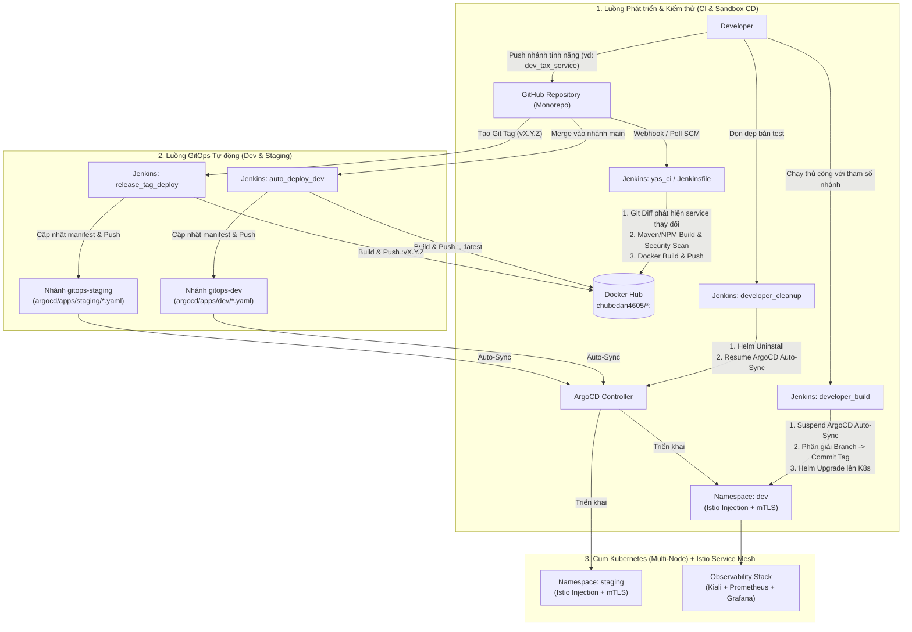
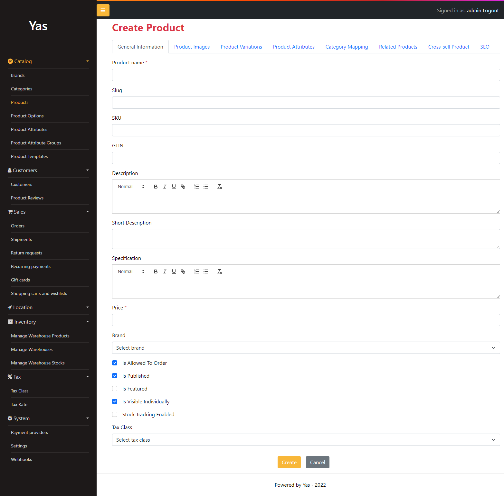
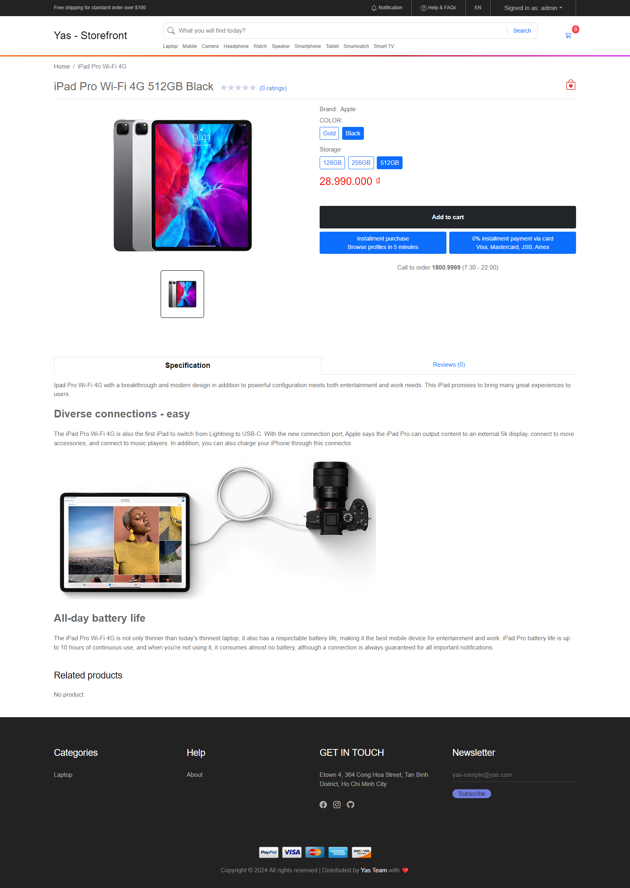
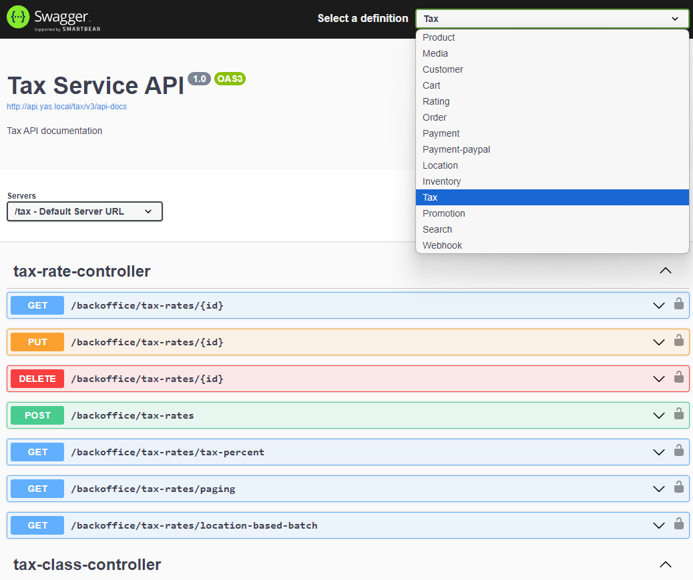
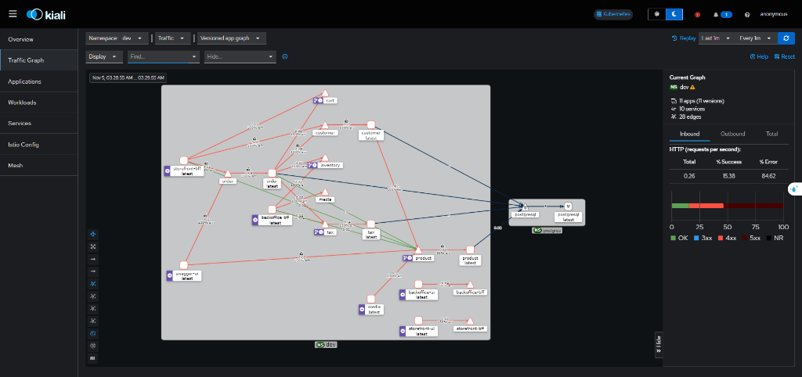
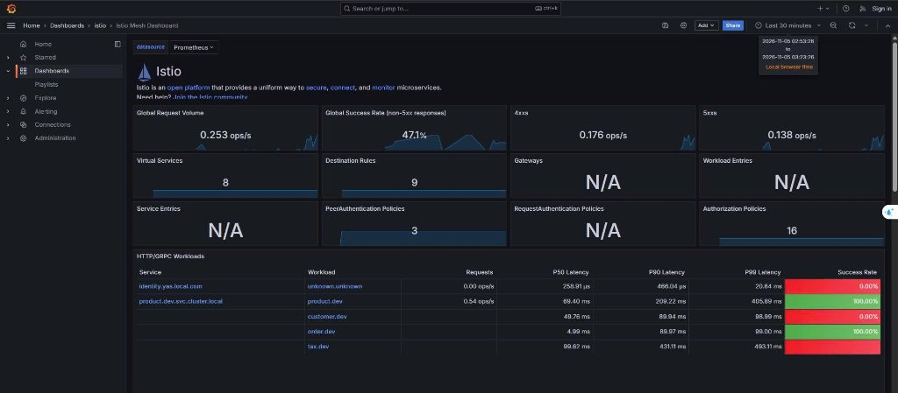
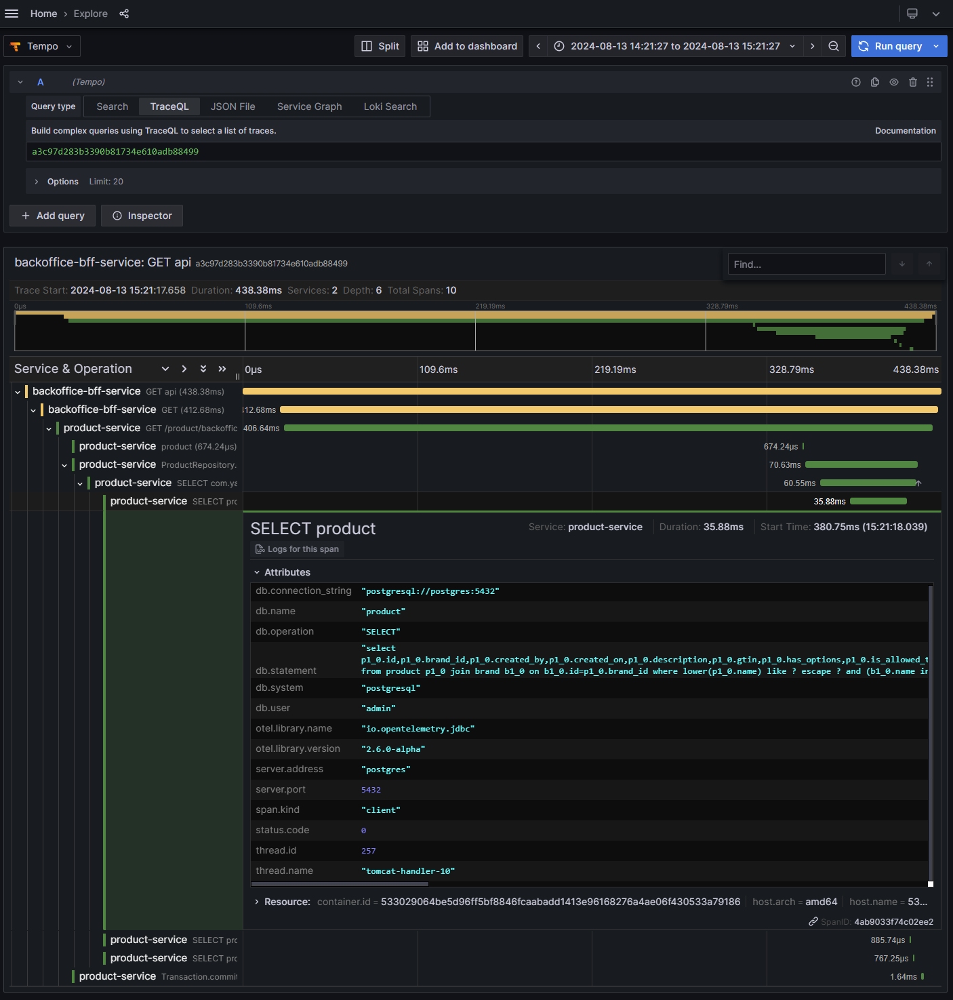

# YAS: Yet Another Shop — Hệ thống CI/CD, GitOps, Service Mesh & Monitoring

Dự án xây dựng quy trình **CI/CD tự động hóa hoàn chỉnh, triển khai GitOps đa môi trường, bảo mật giao tiếp với Istio Service Mesh và giám sát tập trung (Observability)** cho hệ thống thương mại điện tử dựa trên kiến trúc Microservices **YAS (Yet Another Shop)**.

---

## 1. Công nghệ & Công cụ sử dụng (Tech Stack)

| Lĩnh vực | Công nghệ / Công cụ | Vai trò trong dự án |
| :--- | :--- | :--- |
| **Ứng dụng (Microservices)** | Java 21, Spring Boot 3.2, Next.js | 13+ dịch vụ Backend & Frontend (`product`, `order`, `cart`, `tax`, `customer`, `inventory`, `media`, `search`, `storefront`, `backoffice`,...) |
| **Cơ sở dữ liệu & Messaging** | PostgreSQL, Redis, Kafka, Debezium, Keycloak | Lưu trữ dữ liệu, bộ nhớ đệm, đồng bộ CDC (Change Data Capture) và xác thực OAuth2/OIDC |
| **Continuous Integration (CI)** | Jenkins (JCasC), Maven, Node.js, Docker Hub | Tự động phát hiện dịch vụ thay đổi, kiểm thử, quét bảo mật, đóng gói và đẩy Docker Image lên `chubedan4605/*` |
| **Code Quality & Security Gate** | Gitleaks, Snyk, JaCoCo, SonarQube | Quét lộ khóa bí mật (Secret scan), lỗ hổng thư viện (Dependency scan), kiểm soát độ phủ test ($\ge 70\%$) và phân tích mã tĩnh |
| **Container Orchestration** | Kubernetes (Minikube Multi-Node), Helm | Quản lý vòng đời Pod, đóng gói template cấu hình và phân bổ tải theo nhãn Node (`type=heavy`, `type=light`) |
| **Continuous Delivery & GitOps** | ArgoCD, Helm Charts, Python Automation | Đồng bộ trạng thái tự động từ nhánh `gitops-dev` và `gitops-staging` vào cụm Kubernetes (`dev`, `staging`) |
| **Service Mesh & Bảo mật mạng** | Istio, Envoy Proxy | Tự động tiêm sidecar (`2/2 Running`), mã hóa **mTLS**, cấu hình Retry/Timeout (`VirtualService`) và phân quyền (`AuthorizationPolicy`) |
| **Giám sát (Observability)** | Kiali, Prometheus, Grafana | Trực quan hóa sơ đồ mạng lưới dịch vụ (Service Mesh Topology), theo dõi lưu lượng (ops/s), tỷ lệ lỗi và độ trễ (P50/P90/P99 Latency) |

---

## 2. Kiến trúc Tổng thể Hệ thống CI/CD & GitOps



---

## 3. Chi tiết Hệ thống Pipelines CI/CD (Jenkins JCasC)

Toàn bộ cấu hình Jenkins được tự động hóa theo mô hình **Configuration as Code (JCasC)** tại [`docker-jenkins/jenkins.yaml`](docker-jenkins/jenkins.yaml), khởi tạo sẵn 5 pipeline chuyên biệt kết hợp cùng [`Jenkinsfile`](Jenkinsfile) kiểm định chất lượng:

### 3.1. `yas_ci` ([`Jenkinsfile-yas-ci`](Jenkinsfile-yas-ci)) — Multibranch CI Pipeline theo Commit ID
- **Mục đích**: Tự động kiểm tra, biên dịch và đóng gói Docker Image cho mọi nhánh phát triển khi có commit mới.
- **Cơ chế hoạt động**:
  1. **Detect Changed Services**: Do dự án sử dụng cấu trúc **Monorepo**, pipeline thực hiện `git diff --name-only origin/main...HEAD` để lọc ra chính xác các thư mục dịch vụ bị thay đổi (`cart`, `order`, `product`, `tax`,...). Chỉ những dịch vụ có thay đổi mới được đưa vào danh sách build nhằm tiết kiệm tối đa thời gian và tài nguyên.
  2. **Build Phase**: Chạy `./mvnw clean package spring-boot:repackage -DskipTests -pl <service> -am` để biên dịch module và các thư viện phụ thuộc (`common-library`), sau đó lưu trữ (archive) file `.jar`.
  3. **Docker Build & Push**: Trích xuất mã **Short Commit ID** (`git rev-parse --short HEAD`), đóng gói image và đẩy lên Docker Hub theo định dạng:
     ```text
     chubedan4605/<service>:<commit_id>
     ```

### 3.2. Root `Jenkinsfile` ([`Jenkinsfile`](Jenkinsfile)) — Quality & DevSecOps Gate
- **Mục đích**: Đóng vai trò cổng kiểm soát chất lượng và bảo mật nghiêm ngặt (DevSecOps) trước khi hợp nhất mã nguồn.
- **Các giai đoạn kiểm tra**:
  1. **Frontend Build & Test**: Tự động tải Node.js, chạy `npm install`, `npm run build` và thực thi kiểm thử Jest kèm báo cáo độ phủ cho `storefront` và `backoffice`.
  2. **Security Scan (Gitleaks)**: Quét toàn bộ lịch sử commit mới bằng Gitleaks cấu hình tại [`gitleaks.toml`](gitleaks.toml) để ngăn chặn rò rỉ khóa bí mật, token hoặc mật khẩu.
  3. **Dependency Vulnerability Scan (Snyk)**: Kiểm tra lỗ hổng bảo mật trong các thư viện bên thứ ba của Maven (`pom.xml`) và NPM (`package.json`).
  4. **Unit & Integration Test + Coverage Gate**: Chạy kiểm thử với JaCoCo và áp dụng ngưỡng bắt buộc (**Line Coverage $\ge 70\%$**). Pipeline lập tức dừng nếu độ phủ kiểm thử không đạt chuẩn.
  5. **SonarQube Static Analysis**: Quét chất lượng mã nguồn (Code Smells, Bugs, Security Hotspots) và đẩy báo cáo lên SonarQube Server.

### 3.3. `developer_build` ([`Jenkinsfile-developer-build`](Jenkinsfile-developer-build)) — Parameterized On-Demand CD
- **Mục đích**: Cho phép lập trình viên triển khai tổ hợp các nhánh tính năng bất kỳ của từng microservice lên cụm Kubernetes để kiểm thử tích hợp.
- **Tham số đầu vào**:
  - `NAMESPACE`: Môi trường đích (mặc định: `dev`).
  - `DRY_RUN`: Chế độ chạy mô phỏng (`true`/`false`).
  - `BRANCH_<service>`: Nhánh Git riêng cho từng dịch vụ (`BRANCH_cart`, `BRANCH_customer`, `BRANCH_inventory`, `BRANCH_media`, `BRANCH_order`, `BRANCH_product`, `BRANCH_search`, `BRANCH_tax`, `BRANCH_sampledata`, `BRANCH_backoffice_bff`, `BRANCH_storefront_bff`, `BRANCH_backoffice_ui`, `BRANCH_storefront_ui`).
- **Luồng xử lý thông minh**:
  1. **Suspend ArgoCD Auto-Sync**: Tự động tạm dừng tính năng đồng bộ tự động của ArgoCD trên namespace đích để ArgoCD không ghi đè bản thử nghiệm của lập trình viên.
  2. **Branch-to-Tag Resolution (`resolveBranchToTag`)**: Tự động truy vấn commit mới nhất trên nhánh được chọn của từng dịch vụ, kiểm tra sự tồn tại của image tag tương ứng trên Docker Hub API (fallback về `:latest` nếu nhánh chưa build image riêng).
  3. **Helm Upgrade/Install**: Triển khai từng dịch vụ bằng Helm Chart với image tag đã phân giải.

### 3.4. `developer_cleanup` ([`Jenkinsfile-developer-cleanup`](Jenkinsfile-developer-cleanup)) — Dọn dẹp Sandbox & Khôi phục GitOps
- **Mục đích**: Dọn dẹp toàn bộ các bản cài đặt thử nghiệm từ `developer_build` và trả lại quyền quản lý cho ArgoCD.
- **Luồng xử lý**:
  1. Liệt kê tất cả các bản phát hành Helm (`helm list -n <NAMESPACE> -q`) và gỡ cài đặt (`helm uninstall`).
  2. **Resume ArgoCD Auto-Sync**: Bật lại chính sách `automated: { prune: true, selfHeal: true }` trên toàn bộ ArgoCD Applications thuộc namespace đó và kích hoạt `refresh=hard` để ArgoCD lập tức khôi phục hệ thống về trạng thái chuẩn trên Git.

### 3.5. `auto_deploy_dev` ([`Jenkinsfile-auto-deploy-dev`](Jenkinsfile-auto-deploy-dev)) — GitOps CD cho môi trường `dev`
- **Kích hoạt**: Tự động quét nhánh `main` định kỳ (`H/5 * * * *`) hoặc qua Webhook khi có Pull Request được merge vào `main`.
- **Luồng xử lý**:
  1. Xác định các dịch vụ vừa thay đổi trên nhánh `main` (hoặc build toàn bộ nếu file nền tảng như `pom.xml` gốc hay `common-library/` thay đổi).
  2. Build và đẩy Docker Image với cả 2 tag: `chubedan4605/<service>:<commit_id>` và `chubedan4605/<service>:latest`.
  3. Chuyển sang nhánh **`gitops-dev`**, sử dụng script [`scripts/update-gitops-tag.py`](scripts/update-gitops-tag.py) để cập nhật trường `image.tag` trong các file [`argocd/apps/dev/dev-<service>.yaml`](argocd/apps/dev/) sang mã `<commit_id>` mới.
  4. Commit (`chore(gitops): update dev images to <commit_id>`) và push lên nhánh `gitops-dev`. **ArgoCD** phát hiện thay đổi trên Git và tự động rollout phiên bản mới vào namespace `dev`.

### 3.6. `release_tag_deploy` ([`Jenkinsfile-release-tag`](Jenkinsfile-release-tag)) — GitOps CD cho môi trường `staging`
- **Kích hoạt**: Khi phát hành phiên bản mới bằng Git Tag theo chuẩn Semantic Versioning (`vX.Y.Z`, ví dụ: `v1.0.0`).
- **Luồng xử lý**:
  1. **Validate Tag**: Kiểm tra tính hợp lệ của `RELEASE_TAG` với biểu thức chính quy `^v\d+\.\d+\.\d+$`.
  2. **Build & Push Release Images**: Biên dịch và đóng gói toàn bộ microservices với tag phiên bản chính thức `chubedan4605/<service>:v1.0.0`.
  3. **Update Staging GitOps Manifests**: Chuyển sang nhánh **`gitops-staging`**, cập nhật đồng loạt các file [`argocd/apps/staging/staging-<service>.yaml`](argocd/apps/staging/) sang tag `v1.0.0` và `targetRevision: v1.0.0`.
  4. Commit (`chore(release): deploy release v1.0.0 to staging`) và push lên `gitops-staging` để **ArgoCD** đồng bộ lên namespace `staging`.

---

## 4. Kiến trúc Kubernetes, Helm & Phân bổ tải Multi-Node

Hệ thống Kubernetes được thiết kế gồm 2 nhóm Node với nhãn (`label`) chuyên biệt để tối ưu hóa tài nguyên phần cứng:

- **Node `type=heavy` (`minikube` control-plane)**:
  - Chạy toàn bộ các dịch vụ tiêu thụ nhiều CPU/RAM: Các microservice Backend Java Spring Boot, PostgreSQL, Redis, Kafka, Debezium Connect và Keycloak.
  - Cấu hình trong [`k8s/charts/backend/values.yaml`](k8s/charts/backend/values.yaml): `nodeSelector: { type: heavy }`.
- **Node `type=light` (`minikube-m02` worker)**:
  - Chạy các dịch vụ giao diện người dùng tĩnh/nhẹ (`storefront-ui`, `backoffice-ui`).
  - Cấu hình trong [`k8s/charts/ui/values.yaml`](k8s/charts/ui/values.yaml): `nodeSelector: { type: light }`.

---

## 5. Istio Service Mesh, Bảo mật mTLS & Observability

### 5.1. Bảo mật mạng Zero-Trust (mTLS & AuthorizationPolicy)
- **Sidecar Injection**: Cả 2 namespace `dev` và `staging` đều được gắn nhãn `istio-injection=enabled`. Mọi Pod ứng dụng đều chạy kèm container `istio-proxy` (Envoy) ở trạng thái `2/2 Running`.
- **Mã hóa mTLS ([`istio/mtls/`](istio/mtls/))**:
  - `PeerAuthentication` và `DestinationRule` ép buộc giao tiếp nội bộ giữa các microservice sử dụng **`ISTIO_MUTUAL` (Mutual TLS 100%)**, đảm bảo toàn bộ dữ liệu truyền qua mạng trong cụm được mã hóa và xác thực danh tính qua chứng chỉ SPIFFE.
- **Kiểm soát truy cập ([`istio/security/`](istio/security/))**:
  - Các `AuthorizationPolicy` giới hạn chặt chẽ luồng gọi API theo nguyên tắc đặc quyền tối thiểu (Least Privilege), chỉ cho phép các dịch vụ hợp lệ (như BFF, Order, Cart, Swagger UI) gọi tới các dịch vụ đích được chỉ định.

### 5.2. Quản lý Lưu lượng & Chống lỗi (Traffic Management)
- Cấu hình `VirtualService` tại [`istio/traffic/`](istio/traffic/) thiết lập chính sách **Auto-Retry** (tự động thử lại tối đa 3 lần với timeout mỗi lần 2–3 giây khi gặp lỗi `5xx,connect-failure,refused-stream`), giúp hệ thống tự phục hồi khi có sự cố mạng thoáng qua giữa các pod.

### 5.3. Giám sát Trực quan (Kiali, Prometheus & Grafana)
- **Kiali**: Hiển thị trực quan bản đồ kết nối dịch vụ (Service Topology Graph), tốc độ request theo thời gian thực, tỷ lệ thành công/lỗi và biểu tượng ổ khóa **mTLS 🔒** trên từng cạnh kết nối.
- **Prometheus & Grafana**: Thu thập toàn bộ chỉ số từ Envoy sidecar và Spring Boot Actuator, hiển thị trên **Istio Mesh Dashboard** (Global Request Volume, Global Success Rate, 4xx/5xx rate, P50/P90/P99 Latency cho từng microservice).

---

## 6. Cấu trúc Thư mục Dự án

```text
yas/
├── argocd/                        # Cấu hình GitOps cho ArgoCD
│   └── apps/                      # Application manifests cho môi trường dev & staging
├── docker-jenkins/                # Cấu hình Docker & JCasC (jenkins.yaml) cho Jenkins Server
├── docs/                          # Tài liệu thiết kế, kế hoạch kiểm thử & hướng dẫn cài đặt
├── evidence/                      # Minh chứng kiểm thử thực tế (K8s, Istio, Kiali, Jenkins, DockerHub)
├── helm/                          # Helm Charts triển khai cho từng microservice & môi trường
├── istio/                         # Cấu hình Istio Service Mesh
│   ├── mtls/                      # PeerAuthentication & DestinationRules (mTLS)
│   ├── security/                  # AuthorizationPolicies kiểm soát quyền gọi API
│   └── traffic/                   # VirtualServices cấu hình định tuyến & Retry policy
├── k8s/                           # Manifests hạ tầng (PostgreSQL, Kafka, Keycloak, Charts cơ sở)
├── scripts/                       # Các script tự động hóa (update-gitops-tag.py, simulate-traffic.ps1,...)
├── screenshots/                   # Ảnh chụp giao diện hệ thống & Dashboard giám sát
├── Jenkinsfile                    # Pipeline CI kiểm tra chất lượng & bảo mật toàn diện
├── Jenkinsfile-yas-ci             # Pipeline CI Multibranch build & push theo Commit ID
├── Jenkinsfile-developer-build    # Pipeline CD triển khai theo tham số nhánh của Developer
├── Jenkinsfile-developer-cleanup  # Pipeline dọn dẹp môi trường thử nghiệm & khôi phục ArgoCD
├── Jenkinsfile-auto-deploy-dev    # Pipeline GitOps tự động cập nhật môi trường dev khi merge vào main
└── Jenkinsfile-release-tag        # Pipeline GitOps phát hành phiên bản tag vX.Y.Z lên staging
```

---

## 7. Hướng dẫn Vận hành & Truy cập Nhanh

### 7.1. Kiểm tra trạng thái cụm Kubernetes & Nhãn Node
```powershell
# Kiểm tra trạng thái 2 node (minikube: type=heavy, minikube-m02: type=light)
kubectl get nodes --show-labels

# Kiểm tra các Pod cùng Istio Envoy sidecar (2/2 Running) trong namespace dev
kubectl get pods -n dev
```

### 7.2. Mở giao diện các công cụ Quản trị & Giám sát
Mở các cửa sổ PowerShell riêng biệt để port-forward từng dịch vụ ra máy trạm:

```powershell
# 1. Giao diện Storefront UI (Khách hàng) -> http://localhost:3000
kubectl port-forward svc/storefront-ui -n dev 3000:3000

# 2. Giao diện Backoffice UI (Quản trị) -> http://localhost:3001
kubectl port-forward svc/backoffice-ui -n dev 3001:3000

# 3. Giao diện Kiali (Service Mesh Topology & mTLS) -> http://localhost:20001
kubectl port-forward svc/kiali -n istio-system 20001:20001

# 4. Giao diện Grafana (Istio & Microservices Metrics) -> http://localhost:3002
kubectl port-forward svc/grafana -n istio-system 3002:3000

# 5. Giao diện ArgoCD (GitOps Dashboard) -> https://localhost:8080
kubectl port-forward svc/argocd-server -n argocd 8080:443
```
*(Jenkins Server chạy trực tiếp trên Docker container tại địa chỉ: **`http://localhost:8899`**).*

### 7.3. Giả lập lưu lượng truy cập để kiểm thử Kiali & Grafana
Chạy script tạo lưu lượng gọi API liên dịch vụ qua cổng HTTP để quan sát sơ đồ mạng lưới trên Kiali và biểu đồ trên Grafana:
```powershell
powershell.exe -File ./scripts/simulate-traffic.ps1 -DurationSeconds 120
```

---

## 8. Hình ảnh Minh chứng Hệ thống (Screenshots)

<table>
    <thead>
        <tr>
            <th>Ứng dụng (Backoffice, Storefront &amp; Swagger)</th>
            <th>Giám sát &amp; Service Mesh (Kiali &amp; Grafana)</th>
        </tr>
    </thead>
    <tbody>
        <tr valign="top">
            <td>
                <p><b>Backoffice UI</b></p>
                
                <p><b>Storefront UI</b></p>
                
                <p><b>Swagger UI</b></p>
                
            </td>
            <td>
                <p><b>Kiali Service Mesh Topology &amp; mTLS</b></p>
                
                <p><b>Grafana Istio Mesh Dashboard</b></p>
                
                <p><b>Grafana Distributed Tracing</b></p>
                
            </td>
        </tr>
    </tbody>
</table>

---